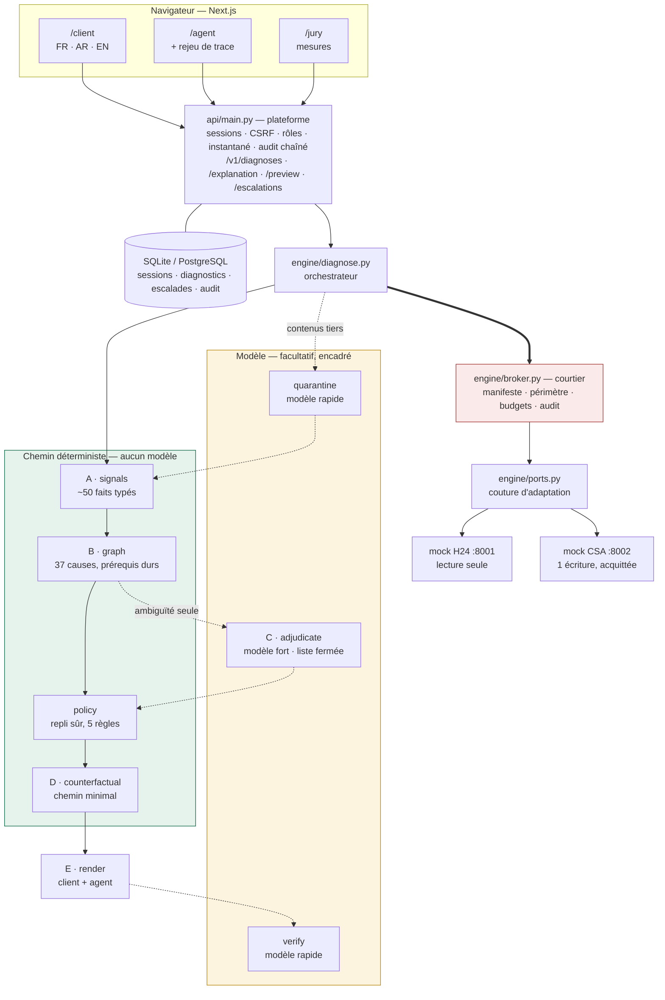

# Architecture

Deux couches : le **moteur** (`engine/`) ne connaît ni sessions ni rôles ; la **plateforme** (`api/`) les ajoute
autour de lui. Voir `docs/fusion.md` pour l'origine de chaque pièce.

## Vue d'ensemble



En vert, ce qui fonctionne toujours. En ambre, ce qui est facultatif. En rouge, le point de
passage obligé de tout accès aux données.

<details>
<summary>Même schéma en texte, pour lecture en terminal</summary>

```
┌──────────────┐   ┌──────────────┐        Navigateur
│  /client     │   │  /agent      │   ┌──────────────┐
│  FR/AR/EN    │   │  + trace     │   │  /jury       │
└──────┬───────┘   └──────┬───────┘   └──────┬───────┘
       └──────────────────┼──────────────────┘
                          │  HTTP (relais Next.js /api → :8000)
                 ┌────────▼─────────┐
                 │   api/main.py    │  /v1/diagnoses · /preview · /escalations
                 └────────┬─────────┘
                 ┌────────▼─────────┐
                 │ engine/diagnose  │  orchestrateur
                 └────────┬─────────┘
         ┌────────────────┼─────────────────┬──────────────┐
         │                │                 │              │
   ┌─────▼─────┐   ┌──────▼──────┐   ┌──────▼──────┐  ┌────▼─────┐
   │ signals   │   │   graph     │   │   policy    │  │  render  │
   │ (faits)   │──▶│ (37 causes) │──▶│ (repli sûr) │─▶│ 2 vues   │
   └───────────┘   └──────┬──────┘   └─────────────┘  └────┬─────┘
                          │ ambiguïté ?                     │
                   ┌──────▼──────┐              ┌───────────▼────────┐
                   │ adjudicate  │              │ verify (ancrage)   │
                   │ modèle fort  │             │ modèle rapide      │
                   └─────────────┘              └────────────────────┘
         ┌────────────────────────────────────────────┐
         │        engine/broker.py  (courtier)        │ ← TOUT passe par là
         │  manifeste · périmètre · budgets · audit   │
         └────────────────┬───────────────────────────┘
                 ┌────────▼─────────┐
                 │  engine/ports.py │  couture d'adaptation
                 └────┬────────┬────┘
              ┌───────▼──┐  ┌──▼────────┐
              │ mock H24 │  │ mock CSA  │   :8001 / :8002 — lecture seule
              │  :8001   │  │  :8002    │   (une écriture : escalade acquittée)
              └──────────┘  └───────────┘
```

</details>

## Les cinq étages

| Étage | Fichier | Nature | Rôle |
|---|---|---|---|
| A | `engine/signals.py` | déterministe | ~50 faits typés depuis l'état du dossier et des API |
| B | `engine/graph.py` + `rules/graph.yaml` | déterministe | score des 37 causes, prérequis durs, inhibiteurs |
| C | `engine/adjudicate.py` | modèle, conditionnel | départage deux familles à égalité, dans une liste fermée |
| D | `engine/counterfactual.py` | déterministe | chemin de déblocage minimal, ordonné par position dans le parcours |
| E | `engine/render.py` | gabarit (+ modèle pour ar/en) | une vue client, une vue agent, depuis le **même** objet |

## Les trois décisions structurantes

**1. Le graphe décide, le modèle traduit.**
Un nœud causal déclare des `requires` : des prérequis factuels sans lesquels la cause est
impossible et obtient un score nul. Le modèle, lorsqu'il intervient, ne peut que réordonner
des candidats déjà validés par les faits — ou dire qu'il ne sait pas. Un identifiant hors
liste est traité comme une non-réponse. Le contrat prime sur la sortie du modèle.

**2. Les citations viennent des ancres, pas d'une recherche.**
Chaque règle du corpus porte une ancre stable (`R-IDN-003`). Chaque nœud causal déclare les
ancres à citer. Une recherche vectorielle peut ramener une règle voisine mais fausse ; une
ancre, non. La recherche lexicale BM25 existe, mais ne sert qu'aux questions libres et ne
peut jamais introduire une règle que la cause n'a pas déjà citée.

**3. Le courtier est la frontière de sécurité, pas le prompt.**
Aucun module du moteur ne touche une source de données directement. Le courtier vérifie
l'appartenance au manifeste, le périmètre de session, l'acquittement humain pour la seule
écriture, et les budgets. Un refus n'est pas une exception silencieuse : il est journalisé et
devient un fait exploitable par le diagnostic.

## Quand l'arbitrage se déclenche — et pourquoi rarement

L'étage C n'intervient que sur une **ambiguïté pure** : plusieurs familles à égalité, et des
référentiels d'accord entre eux. Sur notre kit, cela représente **4,5 % des dossiers**.

L'ordre des règles de politique est délibéré : une contradiction entre H24 et le CSA
**prime** sur l'arbitrage. Le modèle peut départager deux lectures d'un même état ; il n'a
pas autorité pour décider lequel de deux systèmes dit vrai (R-SYN-004). Ce garde-fou d'ordre
a son test dédié.

## Dégradation contrôlée

| Ce qui tombe | Ce qu'il reste |
|---|---|
| Le modèle (pas de clé, pas de réseau) | Diagnostic déterministe complet. Les ambiguïtés ne sont plus tranchées, donc elles partent en validation humaine — le comportement voulu. Pas d'arabe ni d'anglais, et l'interface le dit au lieu d'inventer. |
| Le CSA | Les faits qui en dépendent restent à `False` au lieu d'être devinés. Le refus figure dans la trace. |
| Un budget dépassé | Abstention immédiate avec mention explicite d'une vue du monde incomplète. |

## Reprise du kit officiel

`engine/ports.py` définit l'unique interface vers les données. Le kit officiel de la BNA se
branche en écrivant un port supplémentaire ; aucun autre fichier du moteur ne change. Les
familles de blocage, elles, sont déjà celles du cahier des charges.


## La couche plateforme (`api/`)

| Fichier | Rôle |
|---|---|
| `api/main.py` | Authentification (cookie HttpOnly + CSRF, jeton évaluateur), périmètre de session, instantané, endpoints `/v1`. |
| `api/projection.py` | Vues par rôle : le client ne reçoit ni code de cause, ni fait, ni score, ni trace, ni rien qui révèle une détection. |
| `api/db.py` | Sessions, diagnostics, escalades et **journal d'audit chaîné** (SQLAlchemy ; SQLite ou PostgreSQL). |
| `engine/preview.py` | Simulation « et si ? » : neutralise les prérequis d'une cause sur une copie des faits, rejoue graphe + politique. |

**Instantané.** À chaque diagnostic, la plateforme empreinte l'état des deux sources (dossier H24 + état CSA).
La chaîne de preuve, la simulation et la confirmation d'escalade relisent les sources et refusent (409) si
l'empreinte a changé : on n'explique, ne simule ni n'escalade jamais un dossier qui n'est plus celui diagnostiqué.

**Acquittement humain.** `human_ack` n'est plus un champ de requête : la confirmation exige une session *agent*
authentifiée, et c'est la plateforme qui ouvre la session du courtier avec l'acquittement. Un évaluateur ou un
client ne peut ni préparer ni confirmer.


## Fournisseur de modèle : Groq

Un seul module (`engine/llm/provider.py`) nomme les modèles. Le fournisseur par défaut est **Groq** (API compatible OpenAI,
`https://api.groq.com/openai/v1`) dès que `GROQ_API_KEY` est définie ; sans clé, le moteur tourne sans modèle. Deux niveaux :
`GROQ_MODEL_STRONG` (arbitrage, traduction) et `GROQ_MODEL_FAST` (classification d'injection, contrôle d'ancrage).
Sorties en mode JSON de Groq, **validées** contre les schémas Pydantic, redemandées une fois, sinon repli déterministe.
`make llm-check` teste la clé et les modèles réellement disponibles sur votre compte. Anthropic et Ollama restent disponibles
(`BOUSSOLA_LLM=anthropic|ollama`).
