# Diagrammes d'architecture et UML

Tous les diagrammes sont en [Mermaid](https://mermaid.js.org/) : GitHub les affiche directement, et ils restent
versionnés comme du texte. Ils sont dessinés **d'après le code** (`contracts/models.py`, `engine/`, `api/`,
`compose.yaml`), pas d'après l'intention. Si le code change, le diagramme doit changer.

| # | Diagramme | Type | Répond à la question |
|---|---|---|---|
| 1 | [Contexte du système](#1-contexte-du-système) | C4 niveau 1 | Qui utilise quoi, et avec quels systèmes ? |
| 2 | [Cas d'usage](#2-cas-dusage) | UML cas d'usage | Que peut faire chaque rôle, et que lui est interdit ? |
| 3 | [Conteneurs et déploiement](#3-conteneurs-et-déploiement) | C4 niveau 2 / déploiement | Quels processus tournent, sur quels ports ? |
| 4 | [Pipeline du moteur](#4-pipeline-du-moteur) | Flux | Comment un dossier devient un diagnostic ? |
| 5 | [Diagramme de classes : domaine](#5-diagramme-de-classes--domaine) | UML classes | Quelles sont les données échangées ? |
| 6 | [Diagramme de classes : accès, sécurité, modèle](#6-diagramme-de-classes--accès-sécurité-modèle) | UML classes | Qui a le droit d'appeler quoi ? |
| 7 | [Séquence : un diagnostic](#7-séquence--un-diagnostic-client) | UML séquence | Que se passe-t-il lors d'un clic ? |
| 8 | [Séquence : l'escalade en deux temps](#8-séquence--lescalade-en-deux-temps) | UML séquence | Comment la seule écriture est-elle protégée ? |
| 9 | [Politique d'abstention](#9-politique-dabstention) | Organigramme | Quand le système s'arrête-t-il ? |
| 10 | [Parcours et statuts du dossier](#10-parcours-et-statuts-du-dossier) | UML états | Où le dossier peut-il bloquer ? |
| 11 | [Cycle de vie d'une escalade](#11-cycle-de-vie-dune-escalade) | UML états | Qui peut faire passer l'escalade d'un état à l'autre ? |
| 12 | [Modèle de données](#12-modèle-de-données) | ER | Qu'est-ce qui est stocké ? |
| 13 | [Frontières de confiance](#13-frontières-de-confiance) | Sécurité | Où sont les contrôles ? |
| 14 | [Chaîne d'audit](#14-chaîne-daudit) | Flux | Comment détecter une falsification ? |
| 15 | [Raccordement à la BNA](#15-raccordement-à-la-bna) | Flux | Que remplace-t-on pour passer au réel ? |

---

## 1. Contexte du système

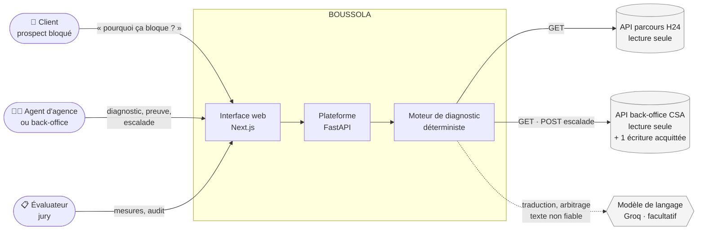

> Le trait pointillé est le seul qui peut manquer : sans modèle, le diagnostic est identique.

---

## 2. Cas d'usage

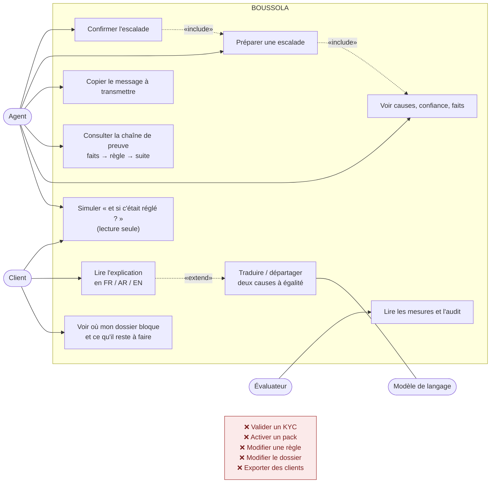

Un client n'atteint que **son** dossier. Un évaluateur ne peut ni préparer ni confirmer une escalade. Les cinq actions
interdites sont déclarées au manifeste d'outils : elles sont refusées par le courtier, pas par une consigne.

---

## 3. Conteneurs et déploiement

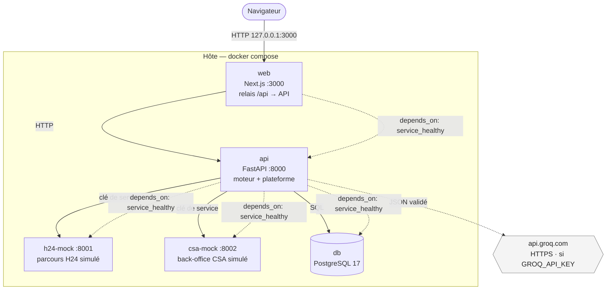

Sans Docker : `make demo` lance les mêmes processus avec SQLite et le kit local (`BOUSSOLA_PORT=local`). Les ports sont
liés à `127.0.0.1` ; seul le service `api` parle au modèle.

---

## 4. Pipeline du moteur

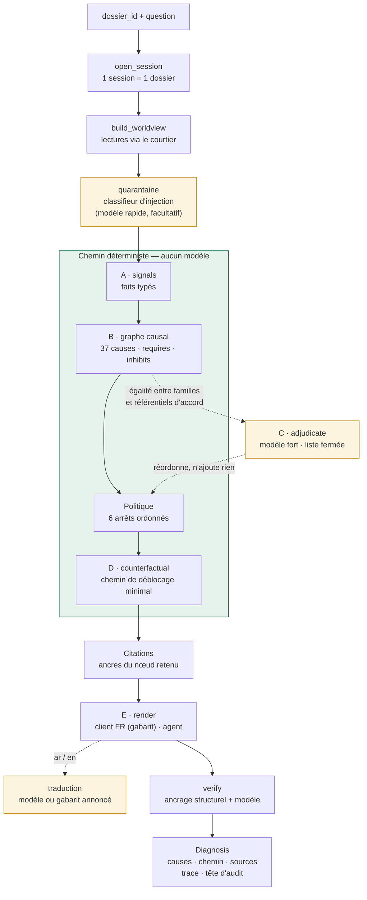

Vert : toujours exécuté. Ambre : facultatif ; en son absence le moteur s'abstient plus souvent, il n'invente rien.

---

## 5. Diagramme de classes : domaine

Les modèles Pydantic de `contracts/models.py`. Les types de la **sortie** (bas) sont ceux de l'API.

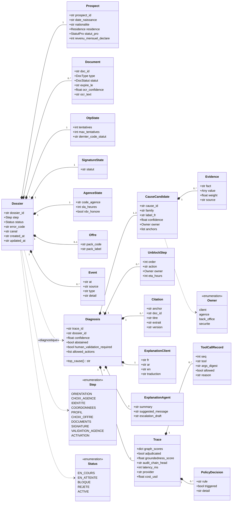

---

## 6. Diagramme de classes : accès, sécurité, modèle

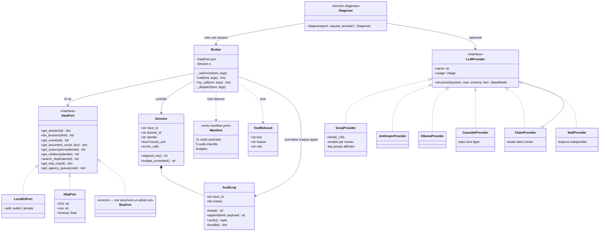

`NullProvider` n'est pas un cas d'erreur : c'est le mode nominal des mesures. Les sorties du modèle sont validées par
Pydantic ; une sortie invalide est redemandée une fois, puis ignorée.

---

## 7. Séquence : un diagnostic client

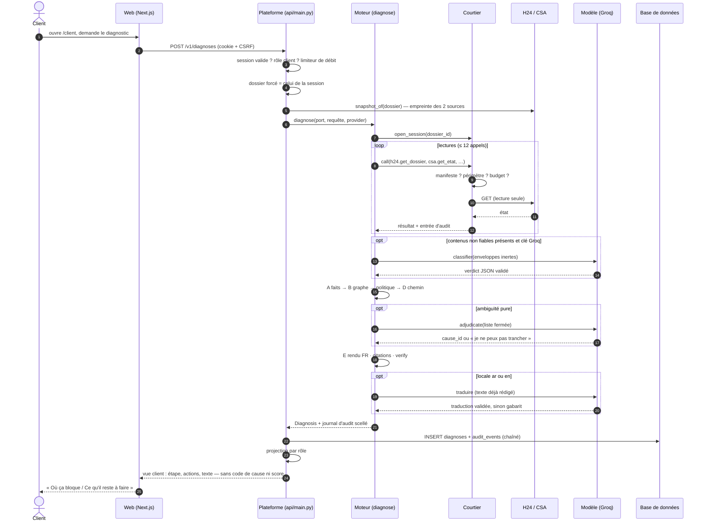

---

## 8. Séquence : l'escalade en deux temps

L'acquittement humain **n'est jamais un champ de requête**. Il est établi par la session agent authentifiée.

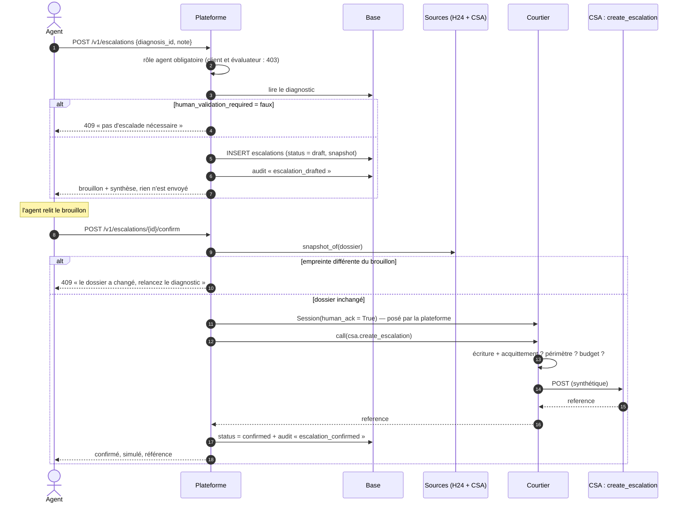

---

## 9. Politique d'abstention

`engine/policy.py` : les contrôles sont **ordonnés**, et le premier qui s'applique arrête l'évaluation. Ordre voulu :
une contradiction entre les deux systèmes (R-SYN-004) prime sur l'arbitrage par le modèle.

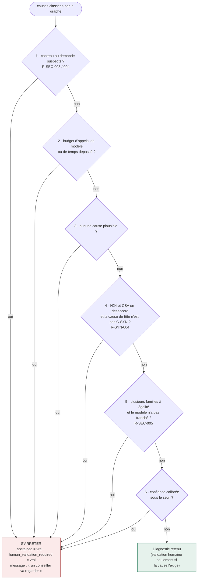

---

## 10. Parcours et statuts du dossier

Les dix étapes du parcours (`Step`), puis les statuts (`Status`). Le diagnostic porte sur l'étape courante.

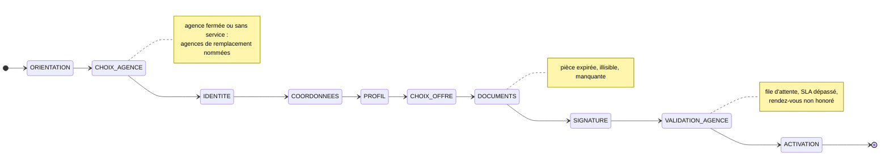

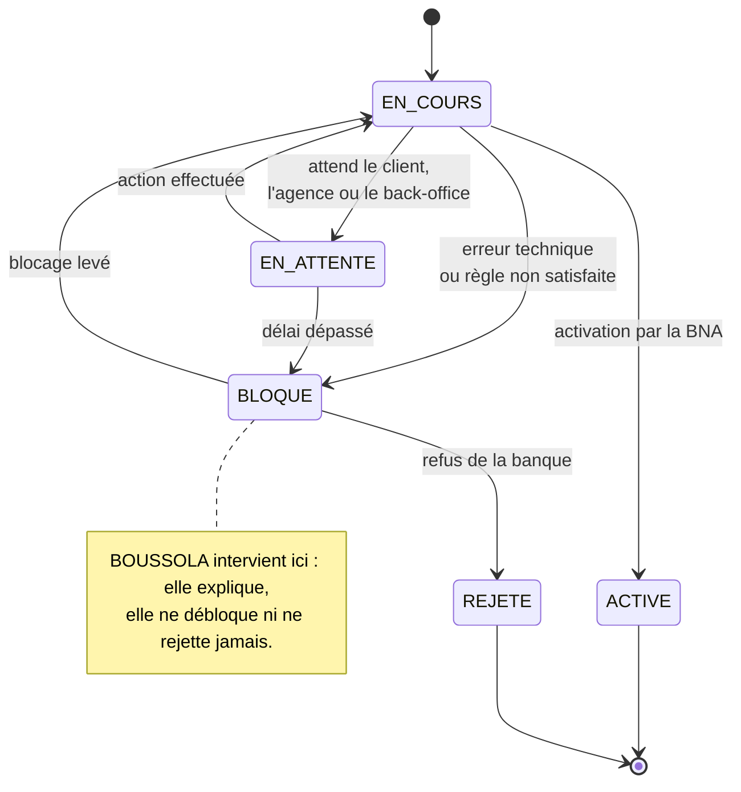

---

## 11. Cycle de vie d'une escalade

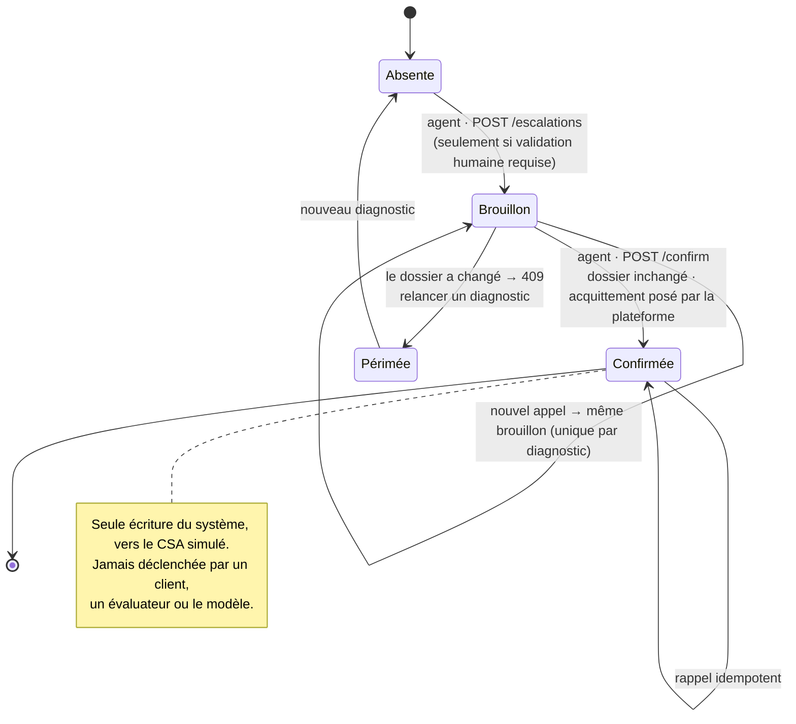

---

## 12. Modèle de données

`api/db.py` — SQLAlchemy ; SQLite en local, PostgreSQL sous Docker. Le jeton de session n'est jamais stocké en clair.

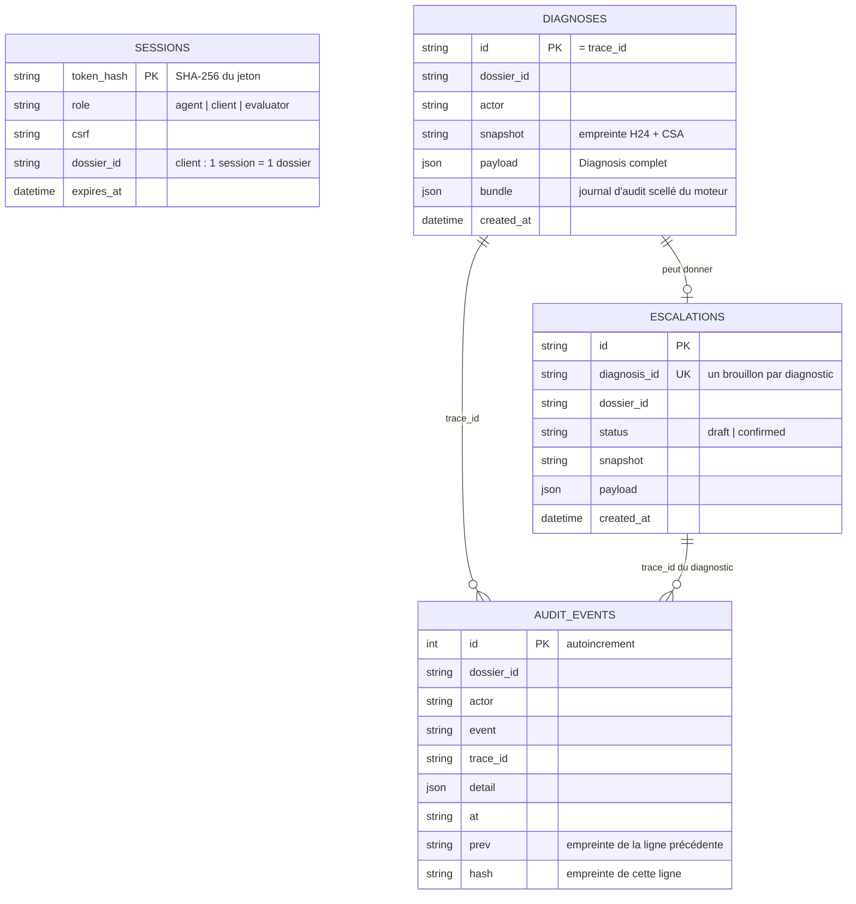

Les relations se font par valeur (`trace_id`, `dossier_id`), sans clé étrangère SQL : le journal d'audit doit rester
lisible même si une ligne métier est un jour purgée.

---

## 13. Frontières de confiance

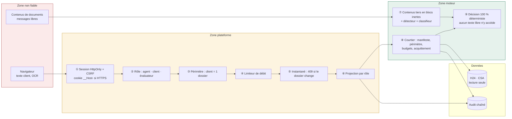

Le contrôle ⑦ est **faible** (détection d'attaques inédites : 8/24) et ne porte donc pas la sécurité : c'est ⑨ qui la
porte (0 dommage sur 50 attaques). Voir [`securite.md`](securite.md) et [`cas-d-echec.md`](cas-d-echec.md).

---

## 14. Chaîne d'audit

Chaque entrée contient l'empreinte de la précédente : modifier ou supprimer une ligne rompt la chaîne.

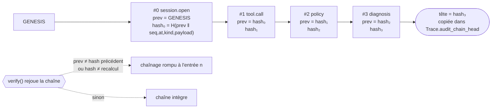

Deux chaînes distinctes : celle du **moteur** (par diagnostic, dans `diagnoses.bundle`) et celle de la **plateforme**
(`audit_events`, globale, écrite en série sous verrou, plus verrou consultatif PostgreSQL).

---

## 15. Raccordement à la BNA

Une seule interface à remplacer : `DataPort`. Rien d'autre dans le moteur ne change.

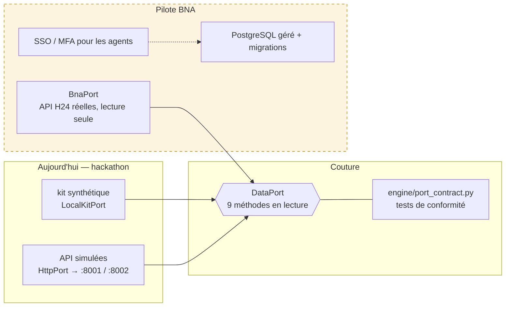

Les cinq phases du pilote (lecture seule → ombre → agents → client assisté → client direct) sont détaillées dans
[`vers-un-pilote.md`](vers-un-pilote.md).
